# LifeCounter 2.5.0
## Notas da atualização · 31/10/2026 · APK code 24

Versão feita pra mesa de verdade: 4 ou 5 pessoas, 40 de vida, partidas de duas horas. Quem cai continua na tela sem roubar espaço, o app pergunta quem matou e como (e isso vira estatística), o sorteio de quem começa lembra das últimas partidas, a mesa vira relógio quando ninguém mexe, e o pódio conta a história da partida numa linha do tempo.

Versão em PDF com os mesmos prints: `docs/release-2.5.0/LifeCounter-2.5.0-notas.pdf` (gerada localmente, fora do git). Página HTML: `docs/release-2.5.0/notes.html`.

---

## 1. Quem começa com justiça

O app guarda quem começou cada partida (o jogador da vez quando o turno 1 termina). O **Sorteio** e a **Roleta** pesam o resultado contra quem começou mais nas últimas 10 partidas da mesa: quem nunca começou tem peso cheio, quem começou uma vez tem um terço, duas vezes um quinto. Os sorteios de habilidade (reflexo, corrida de toques, dado de cada um, mata-mata) continuam puros.

- Configurações › Mesa › Quem começa mostra "Quem começou nas últimas N partidas: Zé 3× · Reis 1× …".
- A nota aparece embaixo do resultado do sorteio.
- No perfil: "começou X (Y%)".

| Configurações › Mesa | Resultado do sorteio |
|---|---|
| 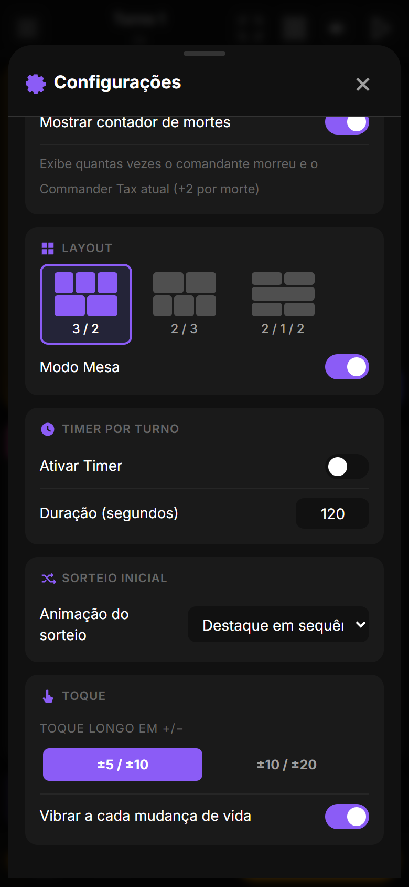 | 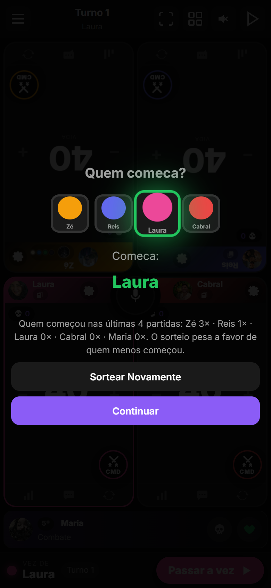 |

## 2. Quem matou e como (pergunta ao cair)

Quando alguém chega a zero (ou 21 de comandante, 10 de veneno, ou é marcado como morto), abre uma pergunta curta: **quem matou?** (os outros jogadores ou "ninguém / ele mesmo") e **como?** (combate, dano de comandante, combo, veneno, mill, desistiu, outro). O app já pré-seleciona o que sabe: dano de comandante marca o atacante e o motivo, veneno marca veneno, "o Reis matou o Zé" por voz marca o Reis.

- "Depois" fecha; dá pra corrigir a qualquer momento tocando na tira do eliminado.
- A resposta vai pro log da partida, pro ranking (eliminado por, motivo) e pras estatísticas do perfil.
- Só pergunta pra quedas recentes: ao retomar uma partida antiga não fica perguntando sobre mortes velhas.

| A pergunta | No perfil |
|---|---|
| 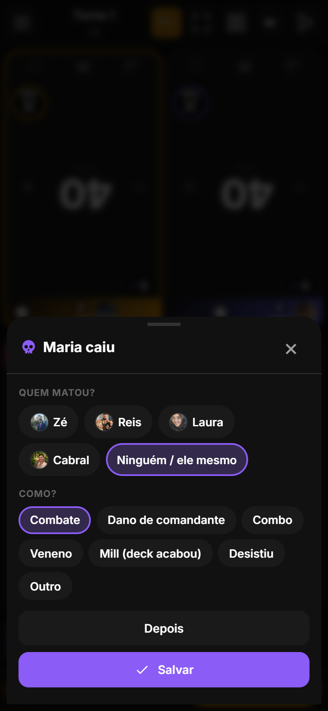 | 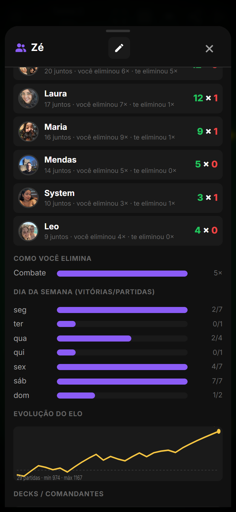 |

## 3. Card de eliminado encolhe (continua visível)

Quem cai vira uma **tira fina embaixo da mesa** com foto, colocação, quem matou e como. Os vivos passam pro layout de uma pessoa a menos: numa mesa de 5, os 4 que sobraram ficam em 2×2 com o dobro do espaço. No modo mesa as rotações são refeitas sozinhas. A tira tem dois botões: corrigir a morte (caveira) e reviver (coração), que devolve o card e o layout de antes.

Ligado por padrão; Configurações › Visual › "Eliminado encolhe" desliga.

| Mesa de 5 | Maria caiu |
|---|---|
| 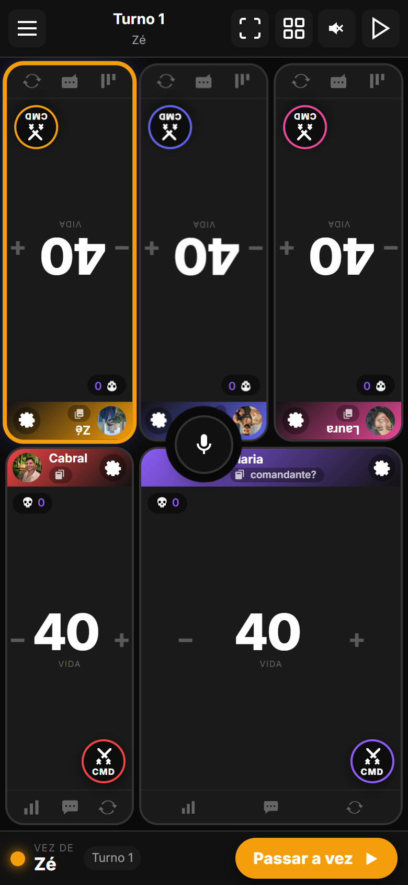 | 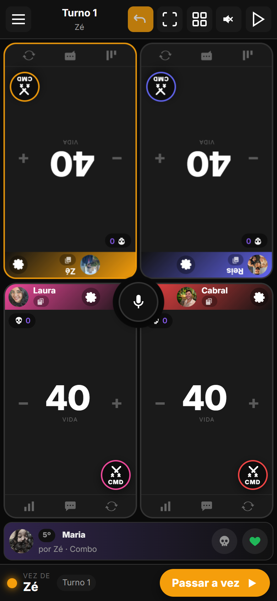 |

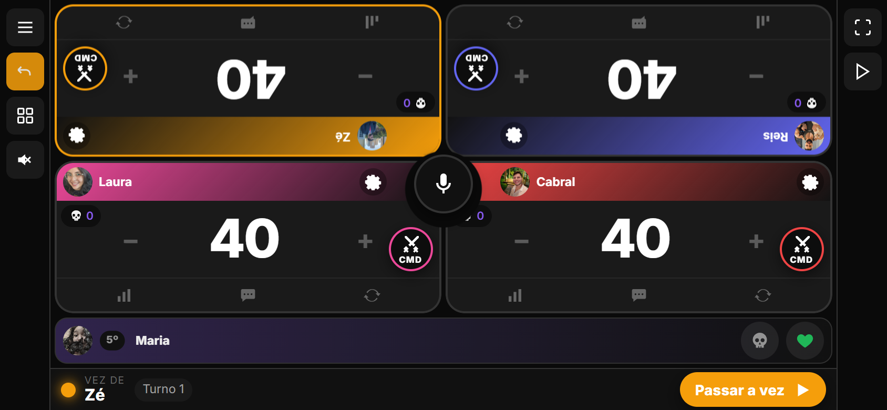

## 4. Pódio com linha do tempo

A tela de vitória ganhou uma **régua da partida**, de 0 até a duração final, com marcas a cada 30 minutos: cada queda (bolinha com a inicial e a cor do jogador; o toque mostra colocação, turno e hora), as trocas de líder (losangos) e o maior swing de vida. Embaixo, os resumos: "Virada: Zé assumiu a ponta no turno 9 (1h12)", "1ª queda: Maria aos 38 min", "3 trocas de líder", "Maior swing: Laura −18 no turno 9".

- A mesma linha do tempo aparece no detalhe da partida no Histórico.
- A imagem compartilhada da vitória ganhou a linha das quedas.

| Vitória | Histórico |
|---|---|
| 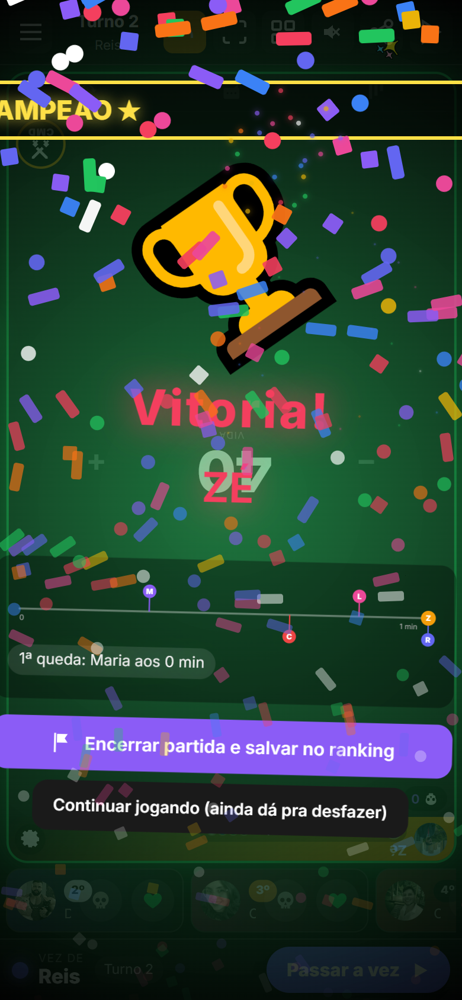 | 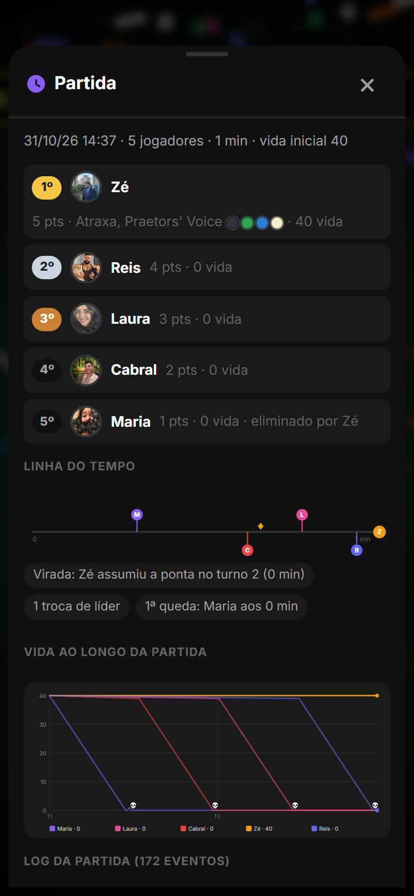 |

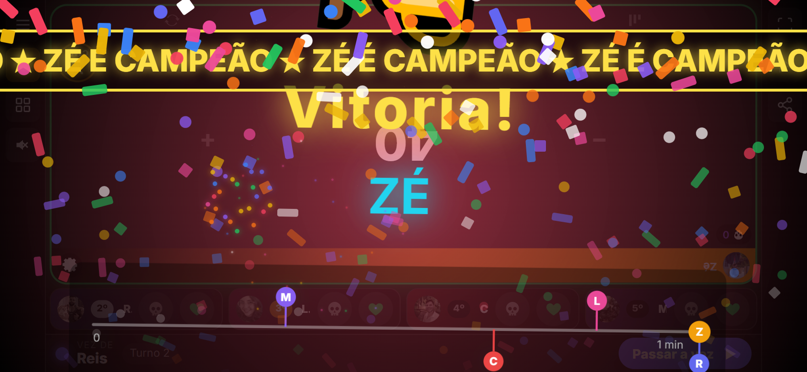

## 5. Descanso de tela com relógio (toque desbloqueia)

Sem toque por 1, 2 ou 5 minutos, a mesa vira **tela preta** (boa pra bateria em OLED) com a hora em números enormes, tempo de partida, turno, de quem é a vez e a vida de cada um. Qualquer toque volta, e o toque de desbloqueio **não vaza** pro card de baixo.

Configurações › Visual › "Descanso de tela": Off, 1, 2 (padrão) ou 5 minutos. Não aparece com modal, sorteio ou pódio abertos; mudança por voz ou pela mesa ao vivo conta como atividade.

| Em pé | Deitado |
|---|---|
| 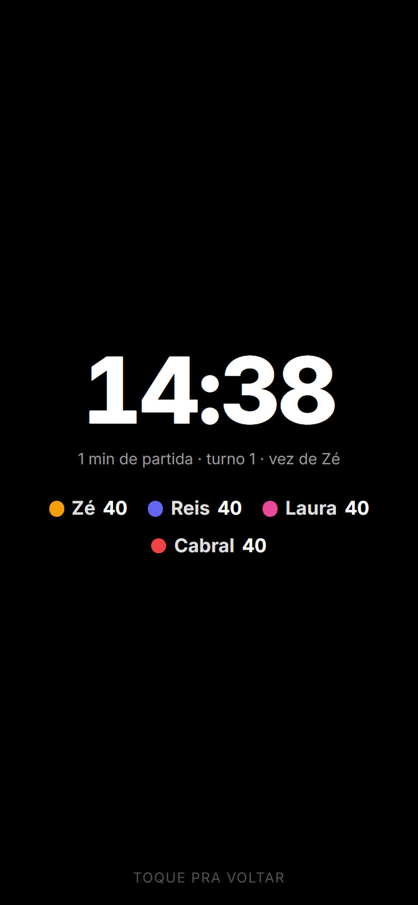 | 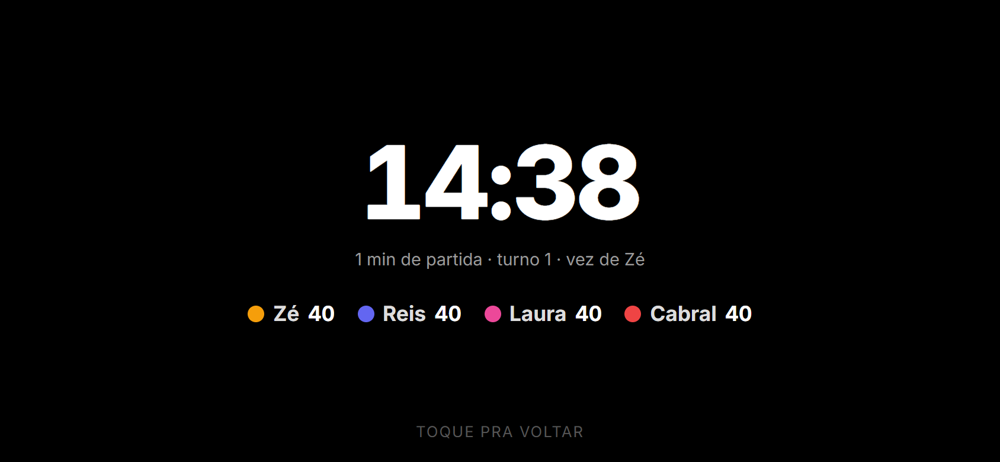 |

## 6. Modo só vida

Card só com o **número gigante** e os botões de mais e menos; somem contadores, comandante, barras de dano e rodapé. Configurações › Visual › "Modo só vida", ou por voz: "modo só vida" / "modo completo".

| Em pé | Deitado |
|---|---|
| 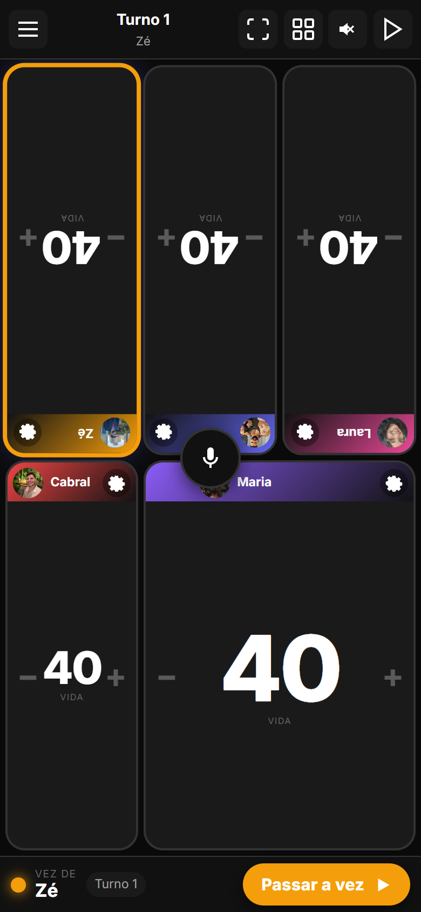 | 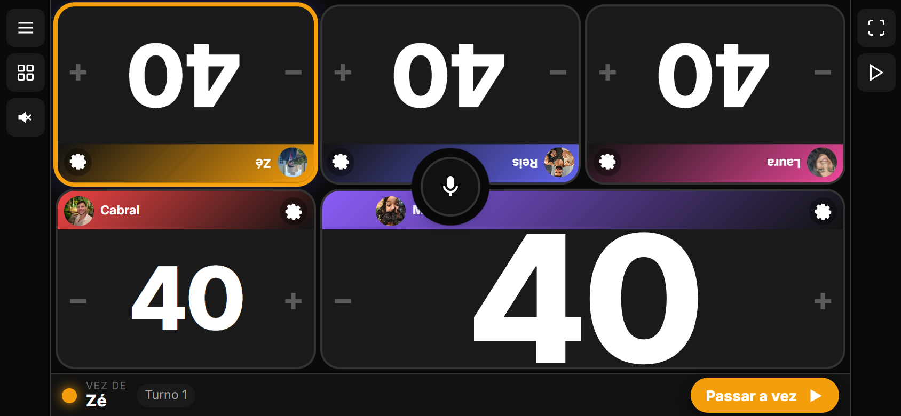 |

## 7. Glossário no toque

Na ficha do comandante, na carta do juiz e na resposta do juiz, as palavras-chave (ward, flash, menace, deathtouch, trample, hexproof…, em inglês ou português) ficam sublinhadas; o toque abre a explicação em português na hora, sem internet e sem IA (base de 49 keywords do app). "Perguntar ao juiz" manda a dúvida pro juiz de IA.

| Glossário | Controles novos |
|---|---|
| 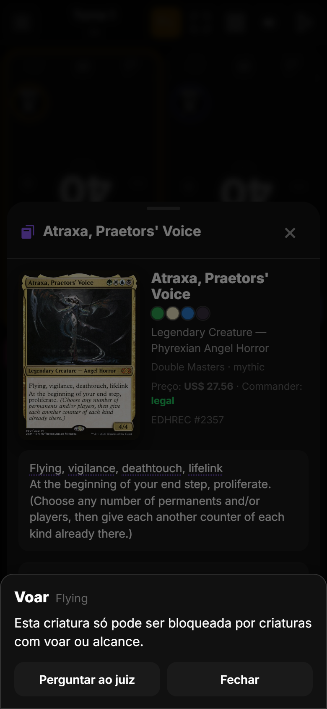 | 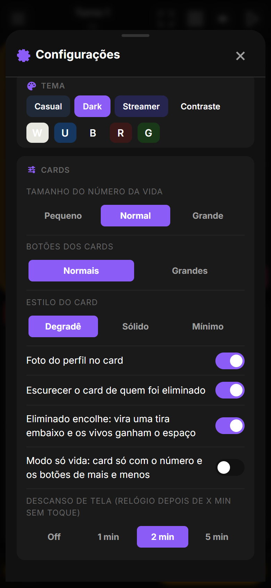 |

## 8. Perfil: como você morre e como elimina

Duas barras novas no perfil: **Como você morre** e **Como você elimina**, mais **quantas partidas você começou** (com porcentagem). Calculado no servidor; partidas antigas sem motivo não entram.

## 9. Nos bastidores

| Onde | O que mudou |
|---|---|
| Partida (servidor) | `starter_profile_id` na partida e `death_cause` em cada colocação (migração 0004). O perfil devolve `death_causes`, `kill_causes`, `starts` e `starts_rate`. |
| Estado da mesa | `starterPlayerId`, `cause` no evento de eliminação, configurações `onlyLife`, `collapseEliminated` e `screenRestMinutes`. Estados antigos migram sozinhos. |
| Voz | "modo só vida" / "modo completo". "Fulano matou o sicrano" pré-preenche a pergunta ao cair. |
| Correção | Mudança de vida que elimina o jogador não dispara mais a animação no card que acabou de virar tira (erro de JS silencioso). |
| Testes | 27 testes do servidor; QA automatizado da mesa com 19 verificações novas, zero erros de JS. |

**Como atualizar.** No Android, o app avisa ao abrir e instala com um toque (ou Configurações › Atualização). No navegador basta recarregar.
