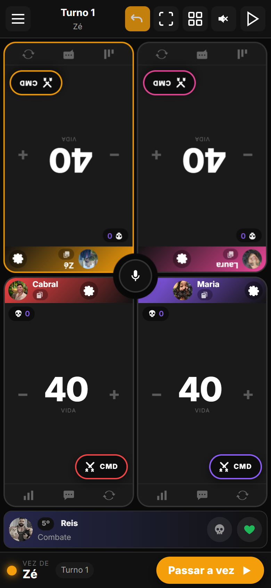
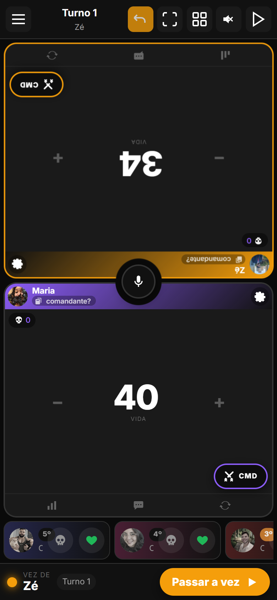
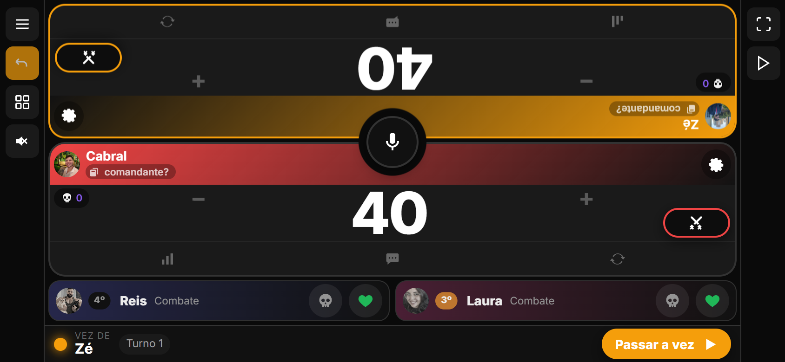
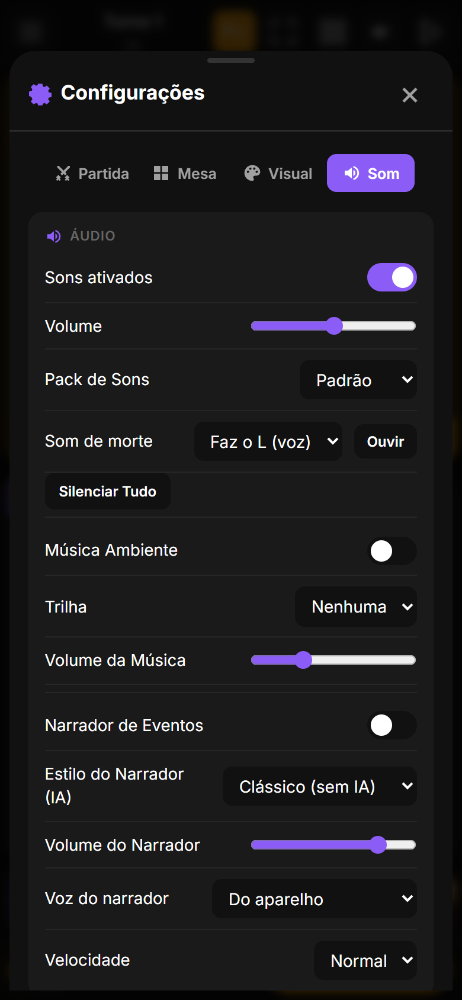
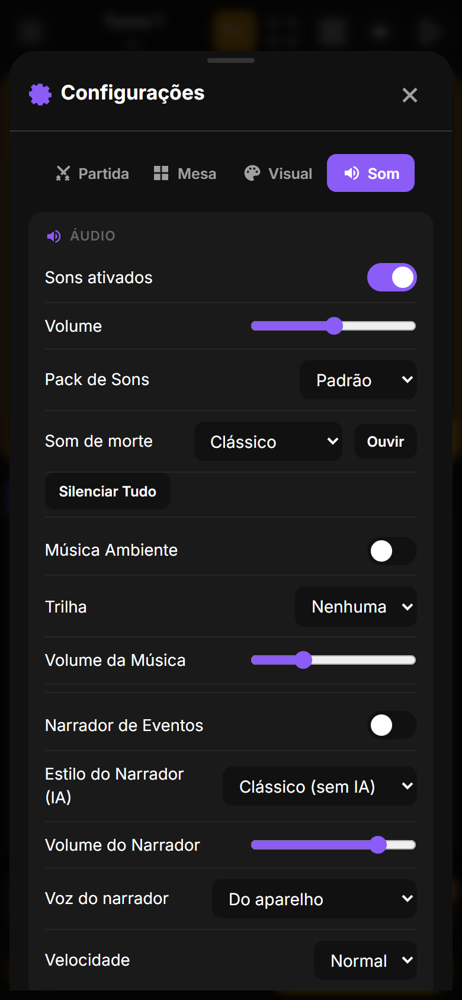
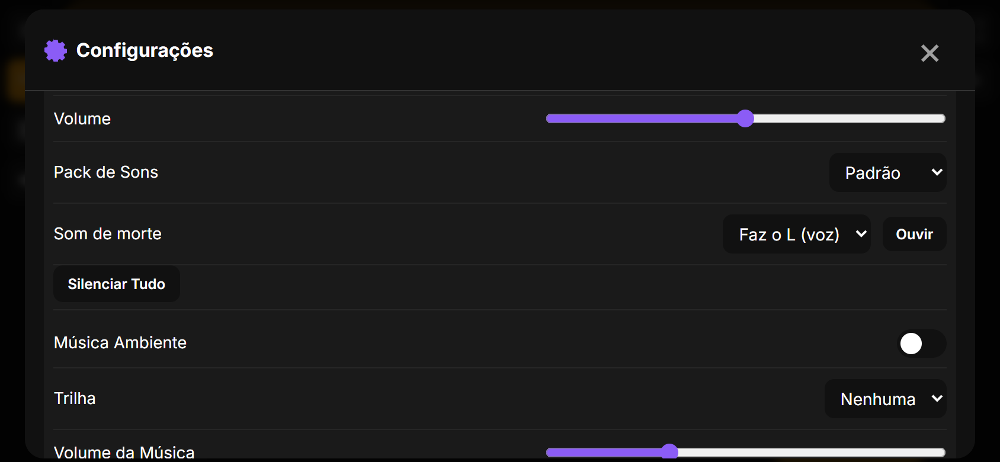

# LifeCounter 2.5.3
## Notas da atualização · 31/10/2026 · APK code 28

Versão de som. Quando alguém é eliminado, em vez do "fon fon fon fooooom" sintetizado, a mesa ouve o áudio do amigo mandando **"faz o L"**. Dá pra voltar ao clássico em Configurações › Som. De quebra, um bug antigo que o áudio novo escancarou foi corrigido: o som de morte repetia a cada toque de vida depois da primeira eliminação.

Versão em PDF com os prints: `docs/release-2.5.3/LifeCounter-2.5.3-notas.pdf` (gerada localmente, fora do git). Página HTML: `docs/release-2.5.3/notes.html`.

---

## 1. "Faz o L" na eliminação

Áudio de voz vindo do WhatsApp (3 s), convertido pra mp3 como os outros sons do app, com 1,1 s de silêncio puro cortado do começo: fica com 2,1 s e começa a falar na hora da queda. Volume compatível com os sons atuais (média -15 dB contra -10 a -17 dB), sem ajuste. Toca no navegador e no APK; mortes seguidas tocam sobrepostas sem cortar.

| Em pé | Três mortes seguidas |
|---|---|
|  |  |

## 2. Voltar ao clássico (ou só ouvir antes)

É a voz de uma pessoa específica; numa mesa com gente de fora pode não fazer sentido. Em **Configurações › Som › Som de morte**: "Faz o L (voz)" ou "Clássico". O botão **Ouvir** toca o que está escolhido. A preferência fica salva no aparelho. "Silenciar tudo" e o modo silencioso continuam valendo.

| Em pé | Clássico | Deitado |
|---|---|---|
|  |  |  |

## 3. Bug antigo: som de morte repetia a cada toque

O QA contou 43 "faz o L" numa partida com duas mortes. Desde a versão dos sons personalizados (fevereiro de 2026), a cada atualização da mesa sem vencedor o app zerava a lista de "mortes já anunciadas" e, no toque seguinte, anunciava de novo quem já tinha caído. Com o fon fon fon de 1 s passava como eco; com voz de 2 s ficou impossível de ignorar. Agora a lista só é zerada em nova partida, reset ou volta pra home. O mesmo conserto vale pro narrador e pra animação de morte por comandante.

## 4. Quem tem som próprio continua com o dele

- Prioridade mantida: som personalizado do jogador (no aparelho) › som do perfil no servidor › som padrão. O "faz o L" é só o padrão novo.
- Rede de segurança: se o mp3 não carregar, o app percebe e toca o fon fon fon sintetizado em vez de ficar mudo.

## 5. Nos bastidores

| Onde | O que mudou |
|---|---|
| Áudio | `faz-o-l.mp3` na raiz (44,1 kHz mono, 2,09 s, -15,3 dB médio, pico -0,8 dB); `build-bundle.mjs` copia pro Android como os outros mp3. Conversão do .ogg (opus) com o ffmpeg do imageio_ffmpeg (o do Playwright é build mínimo, sem opus/mp3). |
| audio.ts | `soundFiles.death`; `failedFiles` + `playSoundFile` devolve `false` quando o arquivo deu erro; `playSynthSound` separado; `deathSound === 'classic'` vai direto no sintetizado. Precedência personalizado › servidor › padrão intacta. |
| Configurações | `settings.deathSound: 'voice' \| 'classic'` (padrão `voice`, com migração); `#death-sound` + `#death-sound-test` na aba Som. |
| ui.ts | `hideShareButtons()` não zera mais `eliminatedPlayersShown`; o zerar foi pros pontos de nova partida/reset/home. |
| Versão | 2.5.3, code 28 (`build.gradle.kts` e `updater.ts`). APK `LifeCounter-v2.5.3.apk` na raiz. |
| Testes | qa14 (26 verificações) instrumenta o `play()` dos áudios e a nota grave do fon fon fon: três mortes em pé, duas deitado, toques depois da morte, Ouvir, Clássico (morte real e reload), som pessoal vencendo o padrão, fallback com mp3 bloqueado. qa13/qa11/qa10 sem regressão; zero erros de JS. |

**Como atualizar.** No Android, o app avisa ao abrir e instala com um toque (ou Configurações › Atualização). No navegador basta recarregar.
