# LifeCounter 2.6.0
## Notas da atualização · 02/11/2026 · APK code 29

Oito coisas pedidas de uma vez. Na mesa: comandantes parceiros contam os 21 de cada um, a troca de líder é anunciada na hora, a música ambiente sente a mesa e o descanso de tela conta curiosidades reais. No ranking: aba de Comandantes com deck contra deck, quanto vale começar, prêmio de maior virada e uma tela pra arrumar os decks do perfil. E o log da partida vai inteiro pro servidor (antes cortava em 500 eventos).

Versão em PDF com os prints: `docs/release-2.6.0/LifeCounter-2.6.0-notas.pdf` (gerada localmente, fora do git). Página HTML: `docs/release-2.6.0/notes.html`.

---

## 1. Comandantes parceiros (Partner, Background)

O dano de comandante era um número por oponente; com dois comandantes, 11 de um e 10 de outro somavam 21 sem ninguém ter matado. Agora cada comandante conta os seus 21.

- Ficha do comandante › **Parceiro / Background**: a busca no Scryfall aceita Backgrounds e o deck vira "A // B" com as cores somadas (com perfil, o deck salvo acompanha).
- Folha de dano: quem tem parceiro aparece em duas linhas. No arrasto do CMD, o popup pergunta de qual comandante é o dano.
- 21 de qualquer um elimina, com causa e matador preenchidos; o log marca o dano do parceiro.

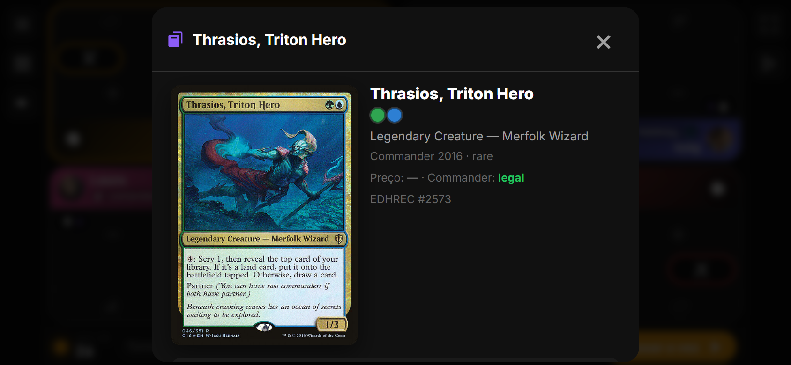
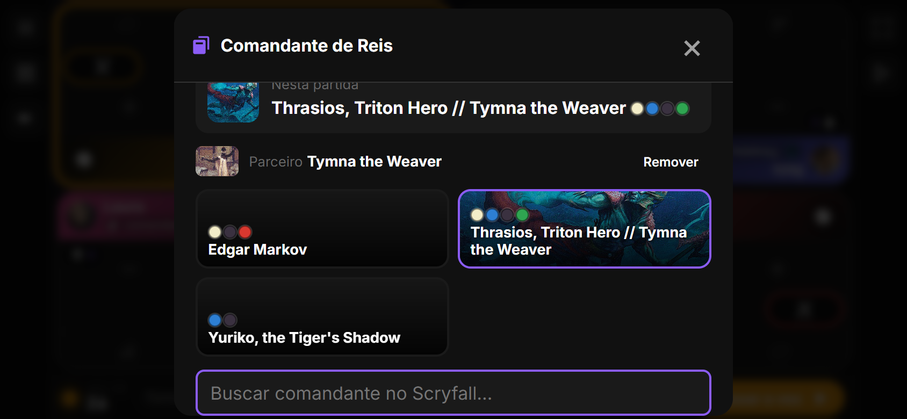
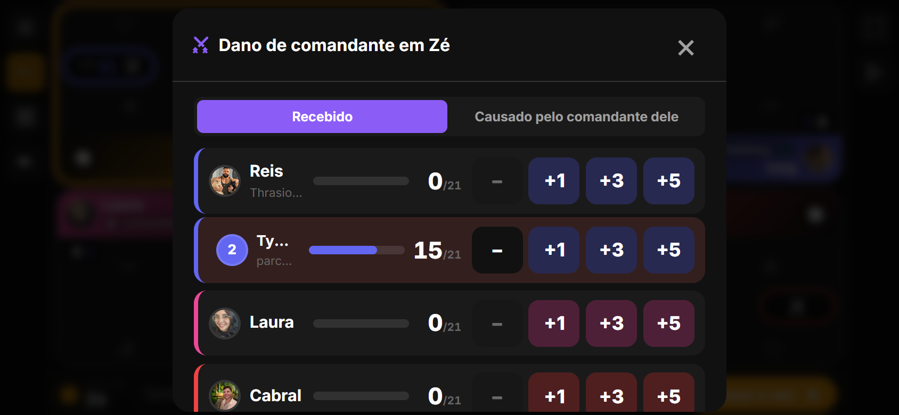
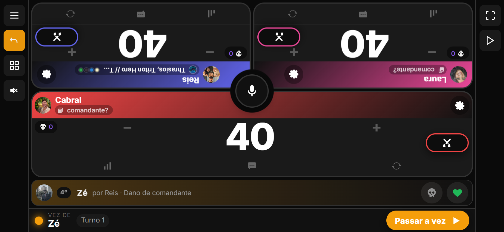

## 2. Virada ao vivo e prêmio "Maior virada"

Quando alguém assume a maior vida da mesa: "Fulano assumiu a ponta no turno N (era Beltrano)", e o narrador fala se estiver ligado. Oscilação de ±1 não conta (2,5 s de estabilidade). Na temporada, prêmio **Maior virada**: quem venceu estando mais atrás do líder em algum momento (mínimo 10 de diferença, reconstruído do log).

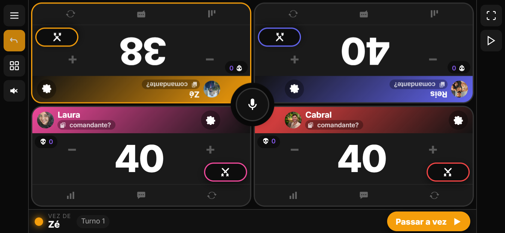

## 3. Trilha que sente a mesa

Configurações › Som › Trilha › **Automática**: calma = Natureza; alguém com ≤5 de vida, ≥8 de veneno ou ≥15 de dano de comandante = Sombria; sobraram dois = Épica. Troca com fade (1,2 s desce, 1,5 s sobe).

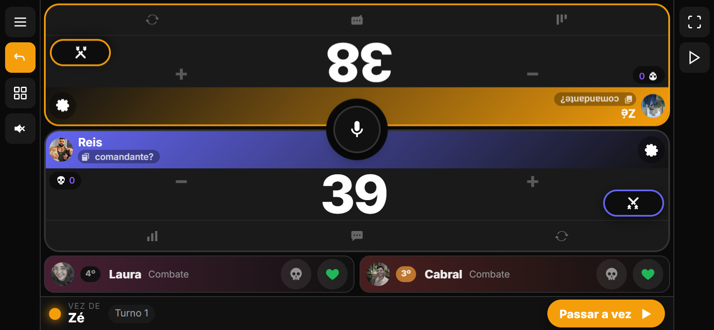

## 4. Descanso de tela com curiosidades

O relógio do descanso rotaciona a cada 20 s um fato real: "X nunca venceu começando", "nêmesis de Y: Z (4×)", "partida mais longa da temporada: 2h18", "comandante da temporada: Atraxa". Vem das estatísticas que o narrador já carrega; sem rede, só o relógio.

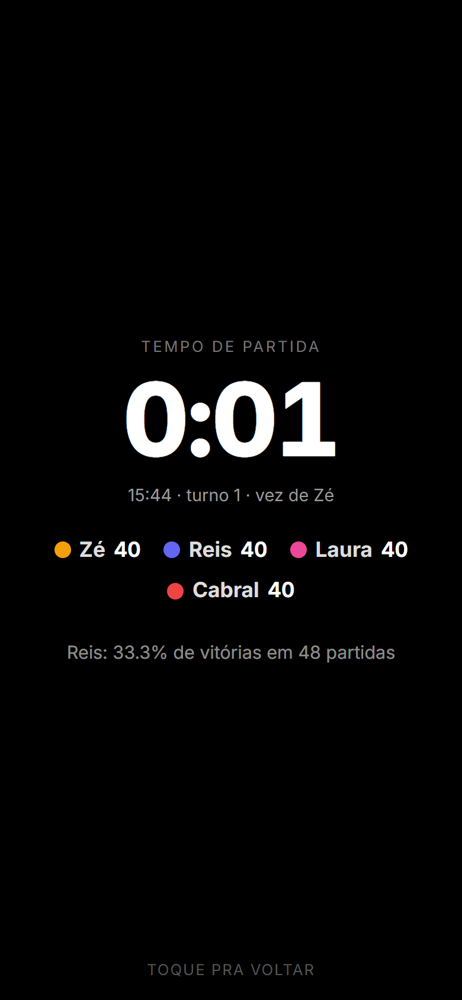

## 5. Ranking por comandante e deck contra deck

Aba **Comandantes** no Ranking: todos os pilotos juntos, com vitórias, partidas, aproveitamento, colocação média e quem pilota. Toque abre o **deck contra deck**: quantas vezes terminou na frente de cada deck que sentou na mesma mesa. Filtro Geral/Temporada.

| Em pé | Deitado |
|---|---|
| 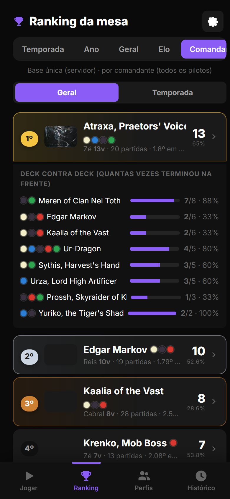 | 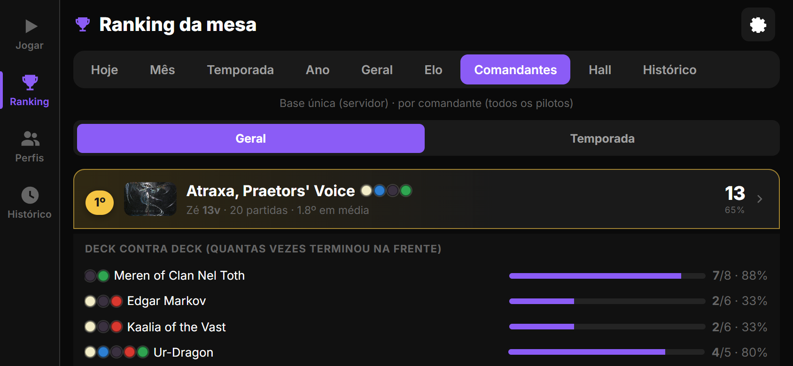 |

## 6. Quem começa vence quanto?

Temporada: "quem começa vence X%" contra o esperado (1/N médio). Perfil: "vence quando começa" contra "sem começar".

| Temporada | Perfil |
|---|---|
| 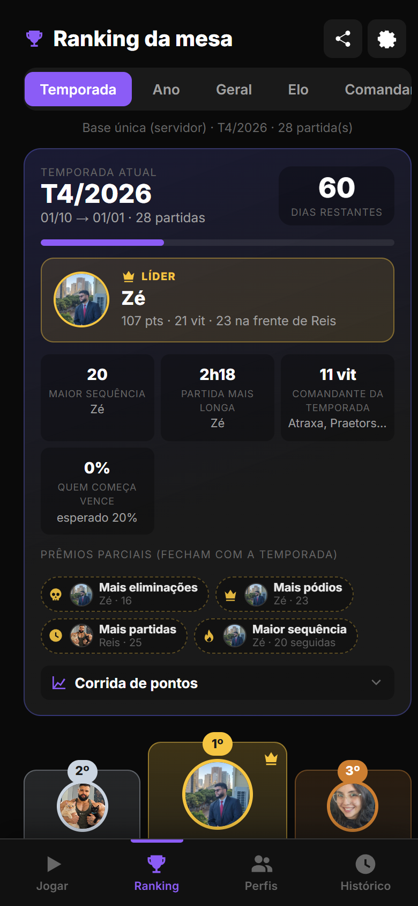 | 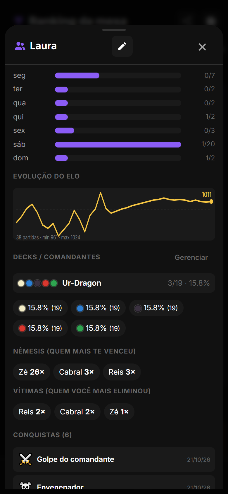 |

## 7. Decks do perfil: renomear, apagar, juntar

Perfil › Decks › **Gerenciar**: renomear, apagar (histórico fica) e juntar (as partidas de um passam pro outro, o duplicado some). Buscar o mesmo comandante de novo devolve o deck que já existe.

| Gerenciar | Renomear | Juntar |
|---|---|---|
| 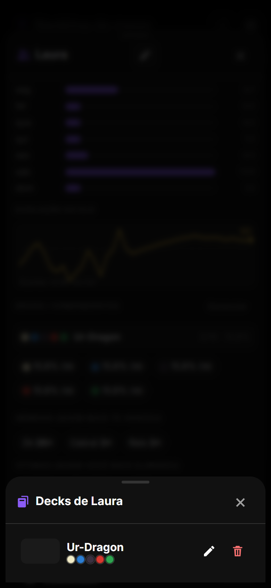 | 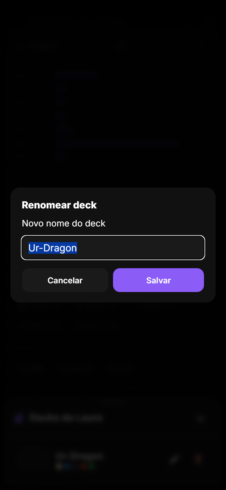 | 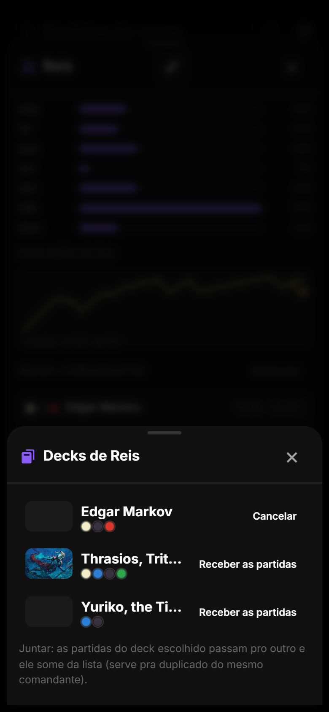 |

## 8. Log inteiro no servidor

O cliente mandava só os primeiros 500 eventos; partida longa perdia o fim (quedas tardias, vitória, final do gráfico, conquistas do fim). Agora vai tudo, até 5000. Testado com 1200 eventos.

## 9. Nos bastidores

| Onde | O que mudou |
|---|---|
| Parceiros | `Player.partnerName/partnerImage/partnerColors`; chave `${id}:2` em `commanderDamage`; `addCommanderDamage(…, slot)`; `EventDetails.slot`; `cmdKeySource/cmdKeySlot/cmdNameFor`; Scryfall com `t:background` no modo parceiro. |
| Virada | `trackLeaderLive` (2,5 s) no `renderGame`; backend `_max_deficit` + prêmio `comeback`. |
| Trilha | `AmbientMusicTrack 'auto'`; `setMood()` com rampa de ganho; `updateTableMood` por render. |
| Descanso | `tableStats` + `seasonFacts` carregados com o contexto do narrador; `restFacts()`; `.sr-fact`. |
| Backend | `GET /api/commanders/?period=`; `POST /api/decks/<id>/merge/`; dedupe no POST de deck; `starts_wins/starts_win_rate/non_start_win_rate`; `starter` no resumo. Testes `tests_lote7.py` (6 novos, 33 no total). |
| Log | `ranking.ts`: `events.slice(0, 5000)`; `deck_name` cortado em 60. |
| Testes | qa15 (parceiro com Scryfall real, virada e oscilação, clima nature→dark→epic, descanso, Comandantes em pé/deitado, temporada, perfil, gerenciador); suítes anteriores sem regressão; zero erros de JS. |

**Como atualizar.** No Android, o app avisa ao abrir e instala com um toque (ou Configurações › Atualização). No navegador basta recarregar.
