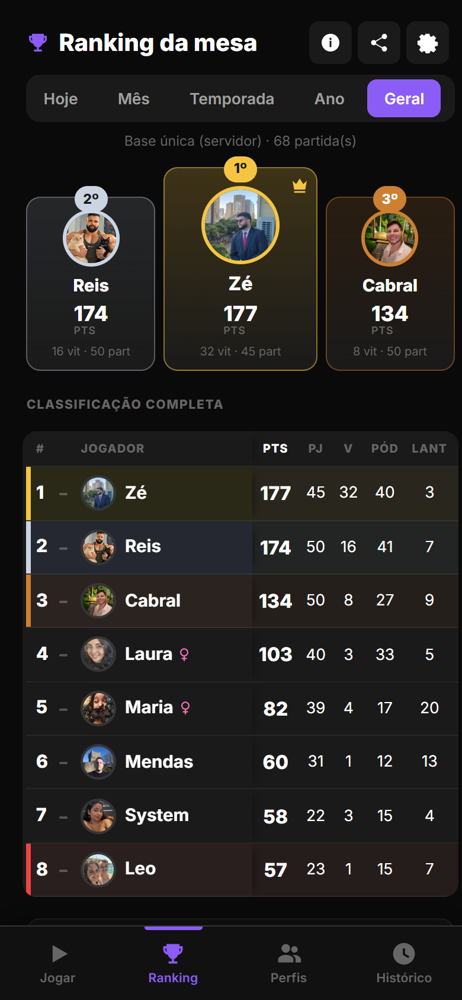
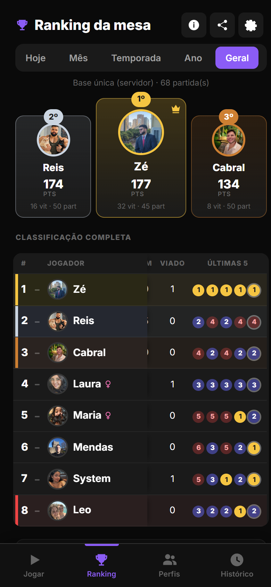
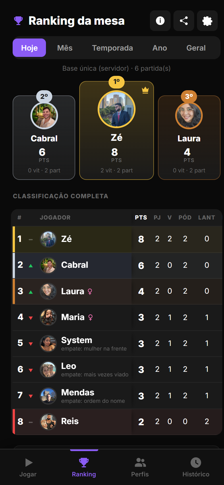
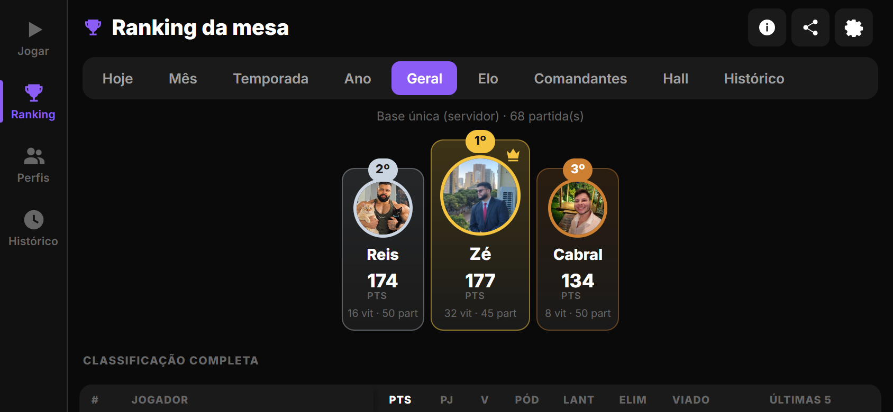
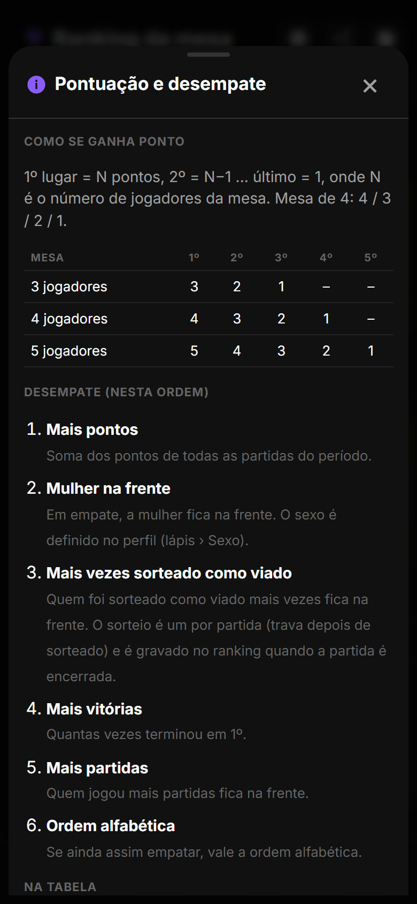
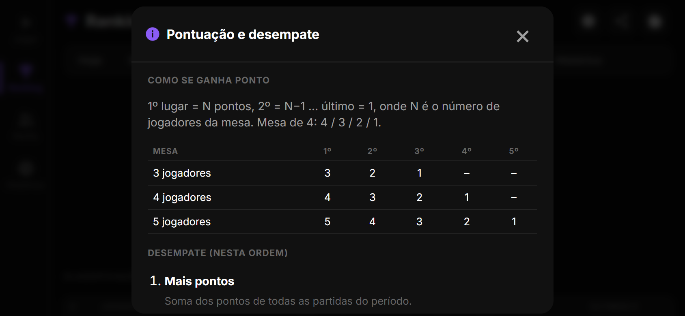
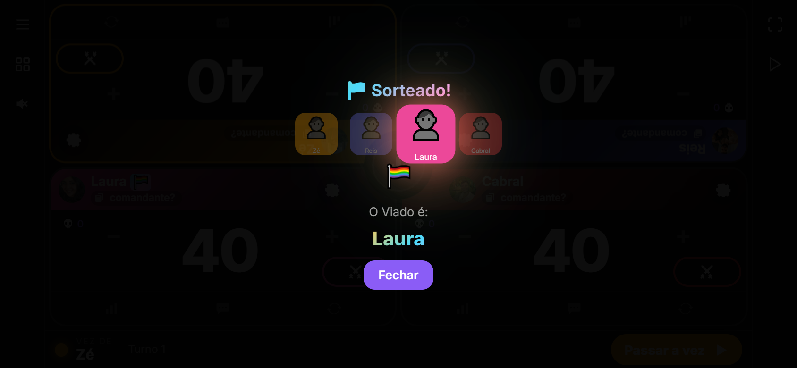
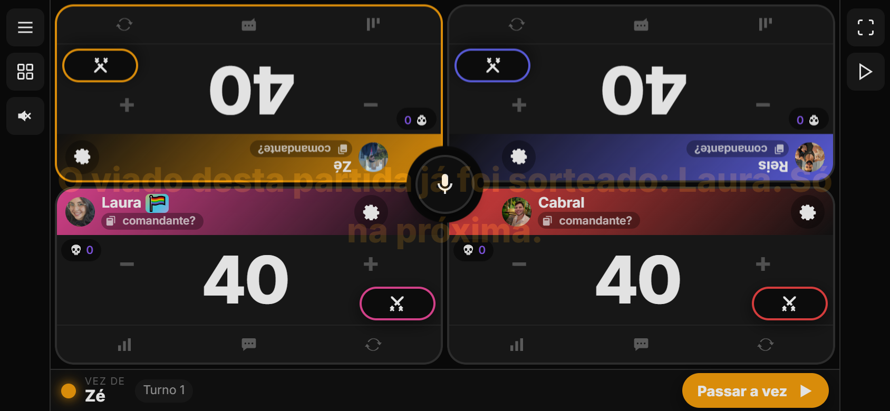
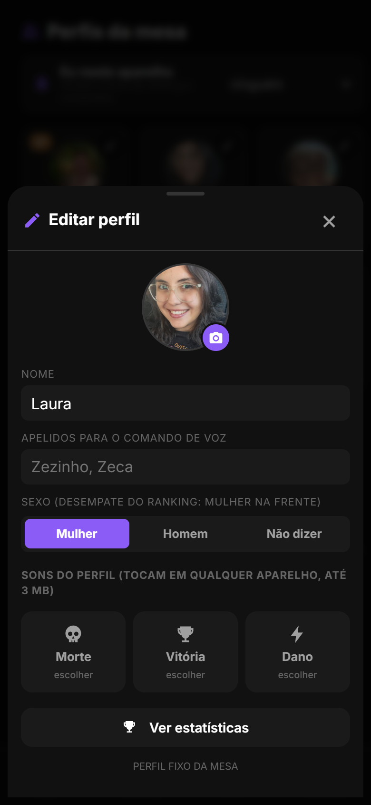
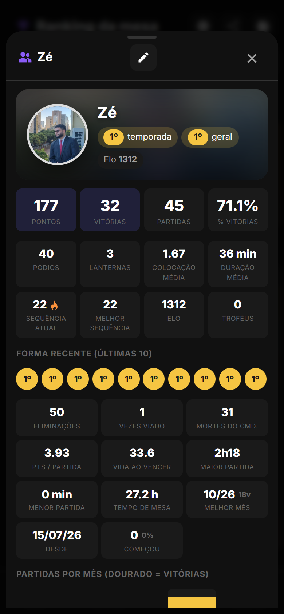

# LifeCounter 2.7.0
## Notas da atualização · 03/11/2026 · APK code 30

O ranking virou tabela de campeonato (estilo Brasileirão), com legenda e botão de informação sobre pontuação e desempate. Dois critérios novos de desempate, nesta ordem: mulher na frente e depois quem foi sorteado como viado mais vezes. O sorteio do viado passou a ser um por partida (trava depois de sorteado) e é gravado no ranking ao encerrar. O perfil ganhou o campo Sexo.

Versão em PDF com os prints: `docs/release-2.7.0/LifeCounter-2.7.0-notas.pdf` (gerada localmente, fora do git). Página HTML: `docs/release-2.7.0/notes.html`.

---

## 1. Tabela de campeonato no ranking (Hoje, Mês, Temporada, Ano, Geral)

A "Classificação completa" virou uma tabela com as colunas de campeonato; o pódio continua em cima e a Temporada mantém o resumo.

- **#** com seta: subiu, desceu ou igual em relação à tabela antes da última partida do período.
- **Jogador** em coluna fixa (a tabela rola pro lado no celular), com o símbolo de mulher ao lado de quem tem sexo feminino no perfil.
- **Pts** pontos · **PJ** partidas · **V** vitórias · **Pód** pódios (1º a 3º) · **Lant** lanternas · **Elim** eliminações · **Viado** vezes sorteado.
- **Últimas 5** (mais antiga → mais recente): dourado vitória, roxo pódio, vermelho o resto, com a colocação dentro.
- Faixas ouro/prata/bronze nos três primeiros e vermelha no último.
- Linha empatada em pontos com a de cima mostra "empate: …" com o critério que a deixou atrás.

## 2. Legenda e botão de informação

Embaixo da tabela: legenda das siglas, regra da pontuação em vigor e os critérios de desempate na ordem. No cabeçalho do ranking, o botão **i** abre "Pontuação e desempate", com tabela de exemplo por tamanho de mesa e a explicação de cada critério.

## 3. Desempate: mulher na frente, depois mais vezes viado

1. Mais pontos (ou mais vitórias, conforme a engrenagem do ranking).
2. Mulher na frente (campo Sexo do perfil).
3. Mais vezes sorteado como viado.
4. Mais vitórias (ou pontos), mais partidas, ordem do nome.

Vale pra abas de período, resumo da temporada, Hall e posição no perfil.

## 4. Sorteio do viado: um por partida, gravado no ranking

Depois de sorteado numa partida em andamento, o botão vira "Viado sorteado (1 por partida)", o "Sortear Novamente" some e novo toque (ou comando de voz) só avisa quem foi. Nova partida ou reset destrava. Ao encerrar, o sorteado vai marcado na colocação e conta na coluna Viado e no desempate.

## 5. Sexo no perfil e "vezes viado"

Folha de edição do perfil (lápis) › **Sexo**: Mulher, Homem ou Não dizer. Laura, Maria e System já vêm como Mulher; os outros perfis fixos como Homem. A página do perfil mostra o símbolo ao lado do nome e o contador "vezes viado".

## 6. Nos bastidores

| Onde | O que mudou |
|---|---|
| Backend | Migração 0005: `Profile.gender` ('', f, m) e `MatchPlacement.viado`. `_aggregate` devolve `gender`, `viado_count`, `kills`, `losses`, `form`, `tie`; `_rank_key` ordena pontos › mulher › viado › vitórias › partidas › nome (ou vitórias primeiro). `GET /api/ranking/` devolve `criteria` e `prev_rank`. Perfil aceita `gender`; `profile_stats` devolve `viado_count`. Seed preenche o sexo dos fixos quando vazio. Testes `tests_lote8.py` (6 novos, 39 no total). |
| App | `GameState.isViadoLocked()`; `applyViado` em `ranking.ts`; `viado` no payload. Ranking: `rankingTableHtml`, `rankingLegendHtml`, `openRankingInfo`, botão `#ranking-info`. Perfil: seletor de sexo. Ícones `ic-info` e `ic-female`. |
| Testes | QA `qa16.mjs` (sorteio trava e grava, desempate por sexo e viado, tabela em pé/deitado, coluna fixa, janela de informação, sexo no perfil). Suítes anteriores sem regressão; zero erros de JS. |

**Como atualizar.** No Android, o app avisa ao abrir e instala com um toque (ou Configurações › Atualização). No navegador basta recarregar.
